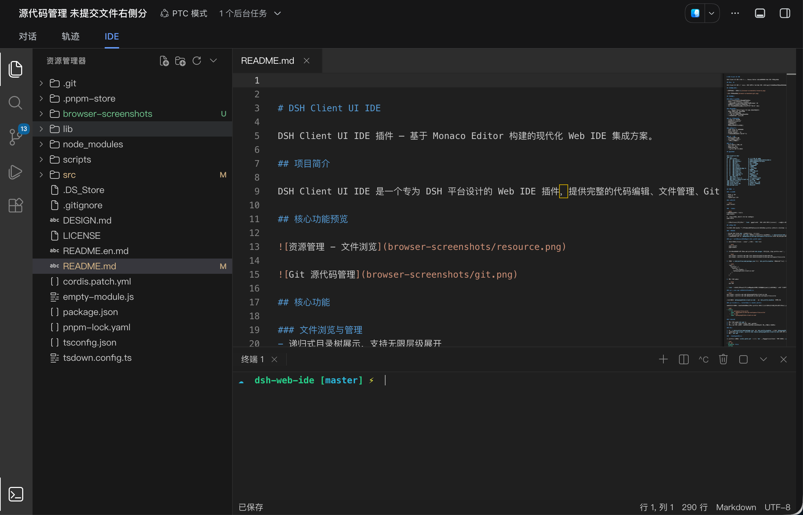
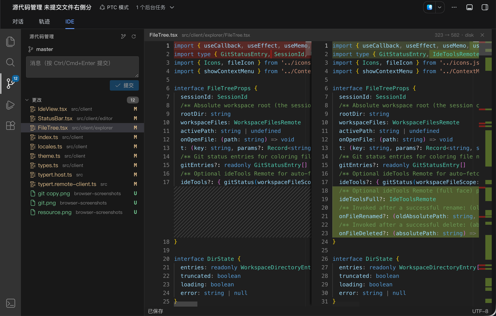

# DSH Web IDE

[](https://www.npmjs.com/package/@zhaoyang10/dsh-web-ide)
[](./LICENSE)
[](./README.md)

A VS Code-style workbench embedded in the DSH session page: file tree, code editing and saving, full Git flow, interactive terminals, run & debug, global search — plus two-way sync with the session. No external services required: file I/O, ripgrep search and node-pty terminals are all served by the plugin's own host service.

| Explorer & Editor | Git Source Control |
| :---: | :---: |
|  |  |

## Quick Start

```bash
# 1. Install into the web profile
dsh plugin --profile web add @zhaoyang10/dsh-web-ide
```

```jsonc
// 2. Append to dsh.profile.bundles in ~/.dsh/profiles/web/package.json
"@zhaoyang10/dsh-web-ide"
```

```bash
# 3. Restart
dsh web
```

Open the **IDE** tab at the top of a session page and you are done — the workspace automatically binds to the session's cwd.

> For development, install from a local checkout: `dsh plugin --profile web add link:/absolute/path/to/dsh-web-ide` (after changes, `pnpm bundle` + restart).

## Features

### File Explorer

- Infinite-depth directory tree with the official Seti file-icon theme, matched by extension
- Create file / folder, rename, delete, cut / copy / paste, download / upload — all validated against the session workspace on the host side
- Git status marks per entry (untracked / modified / staged / deleted / conflict)
- Large files over 2MB paginated automatically; instant filter by name; open a directory in the terminal

### Code Editor

- Monaco Editor (the VS Code kernel) with three themes: Dark 2026 / Dark Modern / Light Modern
- Syntax highlighting, line numbers, code folding, multi-tab management
- Edit and save directly (`Ctrl/Cmd+S`); closing a dirty tab asks save / discard
- Save-conflict detection: when the on-disk file is changed by other tools (or the AI), choose to overwrite or reload
- **F12 / Ctrl+Click go-to-definition** with flash highlight after the jump
- Live view options: Sticky Scroll, render whitespace / control characters
- Real Monaco Editor workers embedded (Blob instantiation) — offline diff highlighting, no CDN

### Markdown Preview

- One-click switch between edit / preview with bi-directional scroll sync
- Syntax-highlighted code blocks; interactive **Mermaid diagrams**: hover toolbar, Ctrl/⌘ wheel zoom, drag to pan, height handle, layout remembered per diagram

### App Menu & Command System

- **Hamburger menu (≡) at the top of the activity bar**: File / Edit / Selection / View / Go / Run / Terminal / Help — icons and interaction ported from VS Code
- Appearance submenu: fullscreen, Zen mode (hide all chrome at once), primary / secondary side bar, status bar, panel, minimap, sticky scroll, render whitespace (nested submenu)
- Go to Line/Column (`Ctrl+G`), next / previous problem (F8 cycles diagnostics)
- **Command palette** (`Ctrl/Cmd+Shift+P`) with fuzzy search and keybinding hints
- **Settings panel**: per-item editor / terminal / appearance options, import & export as JSON
- **Keyboard shortcuts** list with rebinding, **user snippets** (Monaco completions)
- Top-right layout control (a port of the VS Code LayoutControlMenu) and a notification center

### Source Control (Git)

- Change list: stage / unstage / discard per file or all at once
- Commits: regular / amend / signoff / commit & push / commit & sync
- **AI-generated commit messages** written by the current session model
- Branch management: checkout / create / delete, ahead/behind counts, one-click publish
- Graph view of commit history with commit details
- Side-by-side diff editor (the working-tree side is editable and savable), add/remove highlighting
- Full sync operations: fetch / pull / push / sync

### Terminal

- Real interactive terminals powered by node-pty: multiple instances, split and rename
- Built-in **find bar** (regex / case / whole word), scroll-to-bottom, interrupt (Ctrl+C)
- Closing the panel keeps processes alive; reopening replays the scrollback history

### Run & Debug

- **Run the current file**: one click for JS/TS/Python/Go/Rust/C/C++/Ruby/PHP/Shell single files
- **Task discovery**: scans `package.json` / `Makefile` / `Cargo.toml` / `go.mod` / `pyproject.toml` manifests
- **Exit-code tracking**: success / failure per run (code and duration), failure notifications
- **Run diagnostics into the panel**: error lines in build / test output parsed into the Problems panel, click to jump
- **Breakpoints**: click the gutter to toggle, persisted across sessions
- **Node.js debugging** (V8 Inspector, browser-direct, no proxy): pause / resume / stepping, per-frame call-stack navigation, debug-console evaluation
- **Chrome DevTools attach**: take over the same target from `chrome://inspect`

### Global Search

- ripgrep over the whole workspace: regex, case-sensitivity, include globs (e.g. `*.ts`)
- Match counts and truncation notices; click a result to jump to the file and line

### Problems Panel

- Language-service diagnostics merged with run errors, grouped by file
- Error / warning severity filter; click to jump to the file and line

### Platform Integration

- Registers as a session-page tab (Chat → Trace → IDE), removed automatically on uninstall
- **VS Code ecosystem**: open a full VS Code (code-server) instance from the activity bar — extensions and language services included
- Sidebar sync: files opened in the session land in the IDE; browsing the IDE highlights on the session side
- Chinese / English UI following the DSH client language

## How It Works

```
Session tabs: [ Chat ] [ Trace ] [ IDE ]
                              │  browser bundle lib/client.js (React UI)
                              │  typert remote calls
                              ▼
Host service lib/index.js
  file I/O (workspace validation + sandbox fence) · ripgrep · node-pty · git · debug process management
```

- The browser side only renders UI and edits; every file/process operation goes through the host-side `ideTools` remote service, with paths confined to the session workspace.
- Node debugging: the host spawns the target with `--inspect-brk` and the browser connects to the V8 Inspector directly (CDP) — no proxy process.

## Development

Requires Node.js 20.19+, pnpm 8+.

```bash
pnpm install
pnpm bundle      # production build (runs gen:version + monaco worker embed + tsdown)
pnpm watch       # watch rebuild
pnpm test:contract   # remote contract
pnpm test:run-debug  # run features (includes a real --inspect-brk e2e)
pnpm test:debugger   # debugger
node scripts/test-app-menu.mjs   # app-menu regression
```

Customization entry points: themes `src/client/theme.ts`, language map `src/client/language.ts`, locale dictionaries `src/client/locales.ts`, icons `src/client/icons/` (run `node src/client/icons/gen-icons.mjs` after changing assets).

## Publishing (maintainers)

```bash
npm version patch && npm publish   # prepublishOnly runs bundle; the About dialog version comes from package.json automatically
```

## License

[MIT](./LICENSE). Thanks to [Monaco Editor](https://microsoft.github.io/monaco-editor/) · [xterm.js](https://xtermjs.org/) · [Cordis](https://github.com/satorijs/cordis) · [React](https://react.dev/).

---

**Maintainer** [fengzhaoy](https://gitee.com/fengzhaoy) · [Gitee repo](https://gitee.com/fengzhaoy/dsh-web-ide) · [Issues](https://gitee.com/fengzhaoy/dsh-web-ide/issues) · [npm](https://www.npmjs.com/package/@zhaoyang10/dsh-web-ide)
