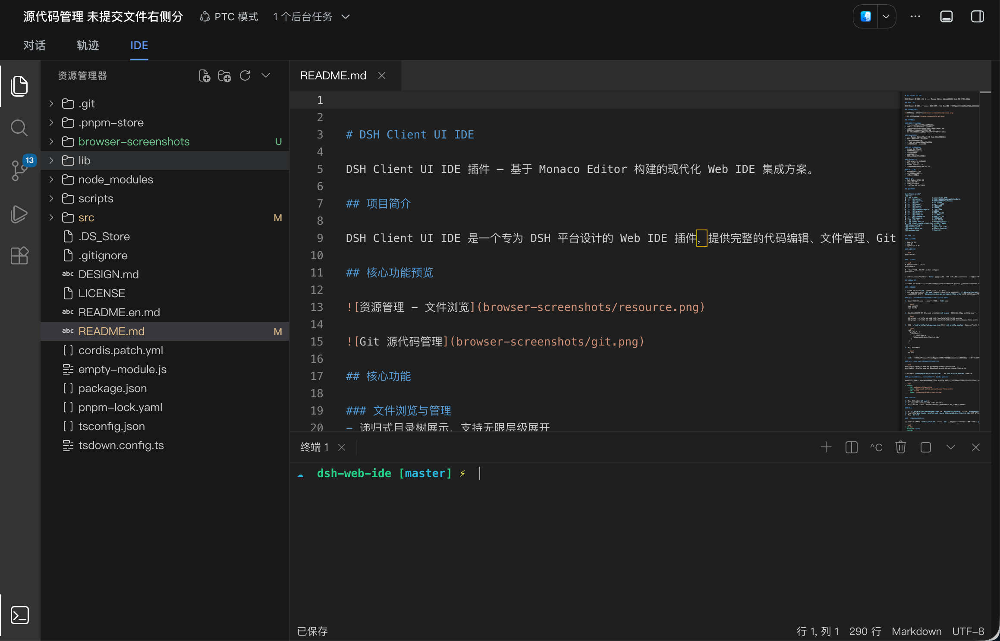
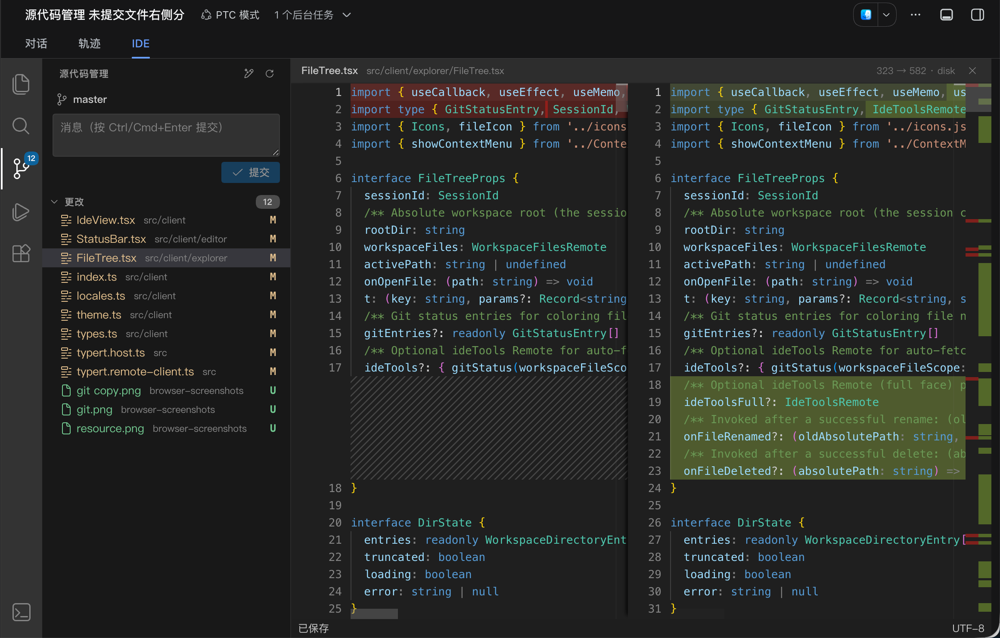

# DSH Client UI IDE

[](https://www.npmjs.com/package/@zhaoyang10/dsh-client-ui-ide)
[](https://www.npmjs.com/package/@zhaoyang10/dsh-client-ui-ide)
[](./LICENSE)

DSH Client UI IDE 插件 — 基于 Monaco Editor 构建的现代化 Web IDE 集成方案。

## 项目简介

DSH Client UI IDE 是一个专为 DSH 平台设计的 Web IDE 插件，提供完整的代码编辑、文件管理、Git 版本控制、终端模拟及全局搜索功能。该插件深度集成于 DSH 工作区，支持暗色主题，拥有流畅的用户体验和高效的开发工作流。

## 核心功能预览





## 核心功能

### 文件浏览与管理
- 递归式目录树展示，支持无限层级展开
- 文件图标自动识别（通过扩展名）
- 基础文件操作：新建文件/文件夹、重命名、删除
- 大文件自动截断展示，优化内存使用
- Git 状态可视化（未跟踪/已修改/已暂存/已删除）

### 代码编辑器
- 基于 Monaco Editor，提供 VS Code 级别编辑体验
- 支持多种编程语言语法高亮
- 行号显示与代码折叠
- 多 Tab 页签管理，支持快捷切换
- 实时文件内容加载与保存

### Git 源代码管理
- 完整的 Git 状态面板
- 文件变更追踪与显示
- 分支信息查看
- 提交历史浏览
- 文件对比（Diff）编辑器

### 终端模拟器
- 集成 xterm.js 终端组件
- 支持多终端实例
- Base64 编码输出传输
- 完善的信号处理（中断/终止）

### 全局搜索
- 支持目录范围搜索
- 结果高亮与路径匹配
- 搜索结果快速定位

### UI 特性
- Dark Modern 暗色主题
- 响应式布局适配
- 右键上下文菜单
- 侧边栏与 IDE 联动交互

## 技术架构

```
dsh-client-ui-ide/
├── src/
│   ├── client/                # 浏览器端 UI 组件
│   │   ├── editor/            # 编辑器组件（TabBar、StatusBar）
│   │   ├── explorer/          # 文件树组件（FileTree）
│   │   ├── git/               # Git 集成面板
│   │   ├── icons/             # SVG 图标资源
│   │   ├── locale/            # 国际化资源
│   │   ├── search/            # 搜索面板
│   │   ├── sidebarBridge.ts   # 侧边栏桥接
│   │   ├── terminal/          # 终端面板
│   │   ├── theme.ts           # 暗色主题定义
│   │   ├── icons.tsx          # 图标组件
│   │   ├── language.ts        # 文件类型映射
│   │   └── index.ts           # 客户端入口
│   ├── index.ts               # Host 端入口
│   ├── typert.host.ts         # 远程方法类型定义
│   └── typert.remote-client.ts# 远程调用客户端
├── tsdown.config.ts           # 构建配置
├── tsconfig.json              # TypeScript 配置
├── cordis.patch.yml           # Cordis 插件补丁
└── package.json               # 项目依赖
```

## 快速开始

### 环境要求

- Node.js 18+
- pnpm 8+
- TypeScript 5.0+

### 安装依赖

```bash
pnpm install
```

### 开发构建

```bash
# 生产构建（产出 lib/）
pnpm bundle

# 开发模式（监听构建，配合 hmr 热更新）
pnpm watch
```

> `@deepseek-ai/*` 系列依赖不在公共 npm 上，在 `devDependencies` 中以 `link:` 指向本机全局 DSH 安装；其他机器检出后请按实际 DSH 安装位置调整这些路径（它们仅参与本地类型检查，不影响发布产物）。

## 安装到 DSH

本插件以 DSH bundle 形式分发。安装分两步：**把插件包装入 profile 依赖**，再把**包名加入 profile 清单的 `dsh.profile.bundles` 数组**。DSH 启动时会自动套用插件自带的 `cordis.patch.yml`，把 `ui-ide` 客户端插件与配套的 `workspace-files-write` 文件写 API 一起注册进 web 客户端 roster，无需手动改 roster。

### 前置条件

- 已安装 DSH CLI（`dsh` 命令可用，建议 0.1.6+）
- 已有 web profile，且 `dsh web` 可正常启动（profile 目录默认在 `~/.dsh/profiles/web`）
- 配套的文件写 API 包 `@deepseek-ai/dsh-api-workspace-files-write`：IDE 的保存/新建/重命名/删除等文件操作依赖它，DSH 本体暂未内置，需一并装入 profile

### 方式一：从 npm 安装（推荐）

1. 构建插件（在本仓库检出目录执行，产出 `lib/`）：

   ```bash
   pnpm install
   pnpm bundle
   ```

2. 把插件与文件写 API 装入 web profile（`dsh plugin` 会把命令转发到 profile 目录执行 `pnpm add`，`link:` 后接绝对路径）：

   ```bash
   dsh plugin --profile web add link:/absolute/path/to/dsh-web-ide
   dsh plugin --profile web add link:/absolute/path/to/dsh-api-workspace-files-write
   ```

3. 编辑 `~/.dsh/profiles/web/package.json`，在 `dsh.profile.bundles` 数组**末尾**追加本插件包名（只需本插件；写 API 由插件 patch 自动注册，不要加入该数组）：

   ```json
   "dsh": {
     "profile": {
       "bundles": [
         "...其他 bundle...",
         "@zhaoyang10/dsh-client-ui-ide"
       ]
     }
   }
   ```

4. 重启 DSH web：

   ```bash
   dsh web
   ```

> `link:` 始终引用源目录，改动后重新构建并重启即可生效；若希望安装时拷贝一份快照，可改用 `dsh plugin --profile web add file:/absolute/path/to/dsh-web-ide`。

### 方式二：本地目录安装（开发调试用）

1. 构建插件（在本仓库检出目录执行，产出 `lib/`）：

   ```bash
   pnpm install
   pnpm bundle
   ```

2. 把插件与文件写 API 以本地 link 方式装入 web profile（`dsh plugin` 会把命令转发到 profile 目录执行 `pnpm add`，`link:` 后接绝对路径）：

   ```bash
   dsh plugin --profile web add link:/absolute/path/to/dsh-web-ide
   dsh plugin --profile web add link:/absolute/path/to/dsh-api-workspace-files-write
   ```

> `link:` 始终引用源目录，改动后重新构建并重启即可生效；若希望安装时拷贝一份快照，可改用 `dsh plugin --profile web add file:/absolute/path/to/dsh-web-ide`。

### 方式三：手动注册 roster（不启用 bundle patch）

若不想把插件列为 bundle（例如仅在某个 profile 临时启用），可以只完成依赖安装，然后在 profile 用户层 `~/.dsh/profiles/web/cordis.patch.yml` 中手动插入 roster 条目：

```yaml
- insert:
    - id: workspace-files-write
      name: '@deepseek-ai/dsh-api-workspace-files-write'
    - id: ui-ide
      name: '@zhaoyang10/dsh-client-ui-ide'
```

### 验证安装

1. 重启 DSH web（`dsh web`）
2. 打开浏览器右侧工具栏，确认 "IDE" 入口可见
3. 点击进入 IDE 界面，检查文件树、编辑器、终端、Git 面板等功能是否正常

### 卸载

1. 从 `~/.dsh/profiles/web/package.json` 的 `dsh.profile.bundles` 中移除 `@zhaoyang10/dsh-client-ui-ide`
2. 移除依赖：`dsh plugin --profile web remove @zhaoyang10/dsh-client-ui-ide`（写 API 不再需要时一并移除）
3. 重启 `dsh web`

### 开发热更新（可选）

在 profile 用户层 `cordis.patch.yml` 中启用 `hmr` 行并指向本仓库，host 侧服务即可在 `pnpm watch` 重建后自动热载（浏览器侧仍需刷新页面）：

```yaml
- id: hmr
  disabled: false
  config:
    base: /absolute/path/to/dsh-web-ide
    root:
      - lib
```

在本仓库执行 `pnpm watch`，并重启一次 `dsh web` 使配置生效。

## 使用指南

### 文件操作

- **打开文件**：点击文件树中的文件或使用搜索功能
- **新建文件/文件夹**：使用顶部操作栏或右键菜单
- **重命名**：右键文件选择重命名
- **删除**：右键文件选择删除（带二次确认）

### Git 操作

- 打开 Source Control 面板查看变更
- 暂存/取消暂存文件
- 编写提交信息并执行提交
- 查看文件历史与差异对比

### 终端使用

- 新建终端实例
- 输入命令执行
- 使用 Ctrl+C 中断当前进程
- 关闭终端实例

### 搜索功能

- 输入搜索关键词
- 选择搜索范围（当前目录/工作区）
- 点击结果跳转至目标位置

## 插件配置

### package.json 入口

```json
{
  "main": "lib/index.js",
  "cordis": {
    "host": true
  }
}
```

### 主题定制

通过 `src/client/theme.ts` 可自定义 IDE 配色方案。当前内置 Dark Modern 主题，符合现代化设计规范。

### 文件类型映射

编辑 `src/client/language.ts` 的 `EXT_MAP` 与 `NAME_MAP` 可扩展支持更多文件类型。

## 浏览器兼容性

- Chrome 90+
- Firefox 88+
- Safari 14+
- Edge 90+

## 版本历史

详见 [CHANGELOG.md](./CHANGELOG.md)（待补充）

## 贡献指南

欢迎提交 Issue 和 Pull Request 共建项目。

1. Fork 本仓库
2. 创建功能分支 (`git checkout -b feature/xxx`)
3. 提交更改 (`git commit -am 'Add xxx feature'`)
4. 推送到分支 (`git push origin feature/xxx`)
5. 创建 Pull Request

## 许可证

本项目基于 MIT 许可证开源，详见 [LICENSE](./LICENSE) 文件。

## 致谢

- [Monaco Editor](https://microsoft.github.io/monaco-editor/) — 强大的代码编辑器
- [xterm.js](https://xtermjs.org/) — 终端模拟器
- [Cordis](https://github.com/kyour-cn/cordis) — 插件框架
- [React](https://react.dev/) — UI 组件库

---

**维护者**: [fengzhaoy](https://gitee.com/fengzhaoy)  
**问题反馈**: [Issue 页面](https://gitee.com/fengzhaoy/dsh-client-ui-ide/issues)