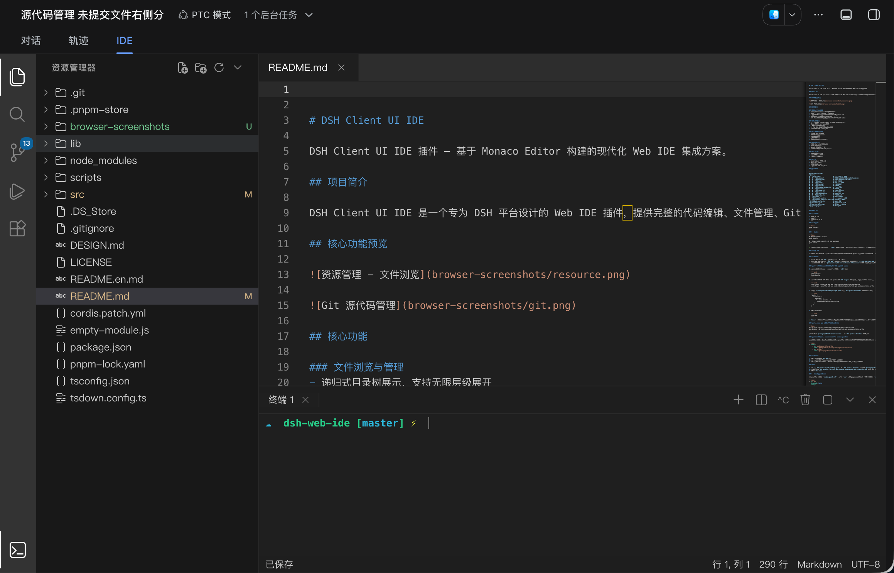
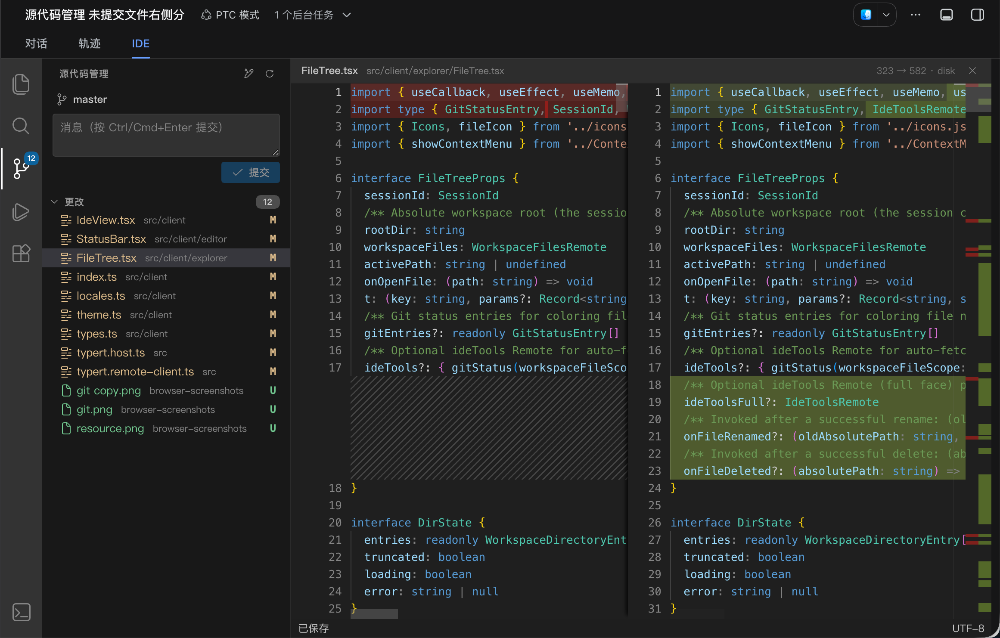

# DSH Web IDE 

[](https://www.npmjs.com/package/@zhaoyang10/dsh-web-ide)
[](./LICENSE)
[](./README.en.md)

在 DSH 会话页内置一个 VS Code 风格的工作台：文件树、代码编辑与保存、Git 全流程管理、交互式终端、运行与调试、全局搜索，以及会话与 IDE 的双向联动。无需任何外部服务——文件读写、ripgrep 搜索、node-pty 终端全部由插件自带的 host 服务提供。

| 资源管理器与编辑器 | Git 源代码管理 |
| :---: | :---: |
|  |  |

## 快速开始

```bash
# 1. 装入 web profile
dsh plugin --profile web add @zhaoyang10/dsh-web-ide
```

```jsonc
// 2. 在 ~/.dsh/profiles/web/package.json 的 dsh.profile.bundles 末尾追加
"@zhaoyang10/dsh-web-ide"
```

```bash
# 3. 重启
dsh web
```

打开会话页顶部 Tab 栏的 **IDE** 即可使用。工作区自动绑定当前会话的 cwd。

> 开发调试可用本地目录安装：`dsh plugin --profile web add link:/absolute/path/to/dsh-web-ide`（改代码后 `pnpm bundle` + 重启生效）。

## 功能特性

### 资源管理器

- 无限层级目录树，Seti 官方文件图标主题，按扩展名自动匹配
- 新建文件 / 文件夹、重命名、删除、剪切 / 复制 / 粘贴、下载 / 上传，全部经 host 侧工作区路径校验，杜绝越界访问
- 文件条目带 Git 状态标记（未跟踪 / 修改 / 已暂存 / 已删除 / 冲突）
- 超过 2MB 的大文件自动分页截断展示；按名称即时筛选；在终端中打开目录

### 代码编辑器

- Monaco Editor（VS Code 同款内核），三套主题：Dark 2026 / Dark Modern / Light Modern
- 常用编程语言语法高亮、行号、代码折叠，多 Tab 页签管理与快捷切换
- 直接编辑并保存（`Ctrl/Cmd+S`），关闭未保存 Tab 时询问保存 / 放弃
- 保存冲突检测：磁盘文件被其他工具（或 AI）改动时，可选择覆盖磁盘或放弃修改并重新加载
- **F12 / Ctrl+Click 转到定义**，符号跳转后高亮闪烁定位
- 粘性滚动（Sticky Scroll）、呈现空白 / 控制字符等编辑器视图选项实时可调
- 内嵌真实 Monaco Editor Worker（Blob 实例化），diff 高亮离线可用，无 CDN 依赖

### Markdown 预览

- 编辑 / 预览双视图一键切换，双向滚动同步
- 代码块语法高亮；**Mermaid 图表**交互渲染：悬停工具栏、Ctrl/⌘ 滚轮缩放、拖拽平移、高度调节，布局按图表记忆

### 应用菜单与命令系统

- **左栏顶部汉堡菜单（≡）**：文件 / 编辑 / 选择 / 查看 / 转到 / 运行 / 终端 / 帮助八大菜单，图标与交互复刻 VS Code
- 外观子菜单：全屏、禅模式（一键隐藏全部 chrome）、主 / 辅侧边栏、状态栏、面板、小地图、粘性滚动、呈现空白字符（三层子菜单）
- 转到行 / 列（`Ctrl+G`）、下一个 / 上一个问题（F8 循环跳转诊断）
- **命令面板**（`Ctrl/Cmd+Shift+P`）模糊搜索全部命令，显示快捷键
- **设置面板**：编辑器 / 终端 / 外观逐项配置，支持导入导出 JSON
- **键盘快捷方式**列表与自定义改键、**用户代码片段**（Monaco 补全）
- 右上角布局控制（复刻 VS Code LayoutControlMenu）、通知中心

### 源代码管理（Git）

- 更改列表：逐文件或全部 暂存 / 取消暂存 / 丢弃变更
- 提交：常规 / 修正（amend）/ 签名（signoff）/ 提交并推送 / 提交并同步
- **AI 生成提交信息**：复用当前会话模型自动撰写提交语
- 分支管理：检出 / 新建 / 删除分支，领先 / 落后计数，一键发布分支
- 图形化提交历史（Graph 视图）与提交详情浏览
- 双栏 Diff 对比编辑器（右栏可编辑并保存）、增删行高亮
- Fetch / Pull / Push / Sync 全套同步操作

### 终端

- node-pty 驱动的真实交互式终端，支持多实例、分屏与重命名
- 内建**查找栏**（正则 / 大小写 / 全字匹配）、滚动到底部、中断（Ctrl+C）
- 关闭面板不终止进程，重新打开自动回放历史输出（scrollback 回放）

### 运行与调试

- **运行当前文件**：一键运行 JS/TS/Python/Go/Rust/C/C++/Ruby/PHP/Shell 等单文件
- **任务发现**：自动扫描 `package.json` / `Makefile` / `Cargo.toml` / `go.mod` / `pyproject.toml` 等清单
- **退出码跟踪**：记录每次运行的成功 / 失败（含退出码与耗时），失败时弹出通知
- **运行诊断入面板**：编译 / 测试输出中的错误行自动解析进 Problems 面板，点击直达
- **断点**：行号左侧单击添加 / 移除，持久化保存
- **调试 Node.js**（V8 Inspector，浏览器直连，无代理进程）：暂停 / 继续 / 单步、调用栈逐帧跳转、调试控制台求值
- **Chrome DevTools 附加**：可从 `chrome://inspect` 接管同一调试目标

### 全局搜索

- 基于 ripgrep 的全工作区检索，支持正则、区分大小写、include glob 过滤（如 `*.ts`）
- 匹配计数与截断提示，点击结果直达目标文件与行

### 问题面板

- 语言服务诊断与运行错误合并展示，按文件分组
- 错误 / 警告分级过滤，点击跳转对应文件与行

### 平台集成

- 注册为会话页 Tab（会话 → 轨迹 → IDE），随插件卸载自动移除
- **VS Code 扩展生态**：活动栏一键打开完整 VS Code（code-server）实例，扩展与语言服务齐全
- 侧边栏联动：会话侧打开的文件自动落入 IDE，IDE 浏览时同步高亮
- 中 / 英双语界面，跟随 DSH 客户端语言设置

## 工作原理

```
会话页 Tab：[ 会话 ] [ 轨迹 ] [ IDE ]
                              │  浏览器 bundle lib/client.js（React UI）
                              │  typert 远程调用
                              ▼
Host 服务 lib/index.js
  文件读写（工作区校验 + sandbox 围栏）· ripgrep · node-pty · git · 调试进程管理
```

- 浏览器侧只做 UI 与编辑；所有文件/进程操作经 host 侧 `ideTools` 远程服务，路径全部限定在会话工作区内。
- Node 调试：host 以 `--inspect-brk` 拉起目标，浏览器直连 V8 Inspector（CDP），无代理进程。

## 开发

要求 Node.js 20.19+、pnpm 8+。

```bash
pnpm install
pnpm bundle      # 生产构建（自动跑 gen:version + monaco worker 内嵌 + tsdown）
pnpm watch       # 监听重建
pnpm test:contract   # 远程契约
pnpm test:run-debug  # 运行功能（含真实 --inspect-brk e2e）
pnpm test:debugger   # 调试器
node scripts/test-app-menu.mjs   # 汉堡菜单回归
```

定制入口：主题 `src/client/theme.ts`、语言映射 `src/client/language.ts`、双语字典 `src/client/locales.ts`、图标 `src/client/icons/`（改 assets 后跑 `node src/client/icons/gen-icons.mjs`）。

## 发布（维护者）

```bash
npm version patch && npm publish   # prepublishOnly 自动 bundle；About 对话框版本号自动取自 package.json
```

## 许可证

[MIT](./LICENSE)。致谢 [Monaco Editor](https://microsoft.github.io/monaco-editor/) · [xterm.js](https://xtermjs.org/) · [Cordis](https://github.com/satorijs/cordis) · [React](https://react.dev/)。

---

**维护者** [fengzhaoy](https://gitee.com/fengzhaoy) · [Gitee 仓库](https://gitee.com/fengzhaoy/dsh-web-ide) · [Issues](https://gitee.com/fengzhaoy/dsh-web-ide/issues) · [npm](https://www.npmjs.com/package/@zhaoyang10/dsh-web-ide)
